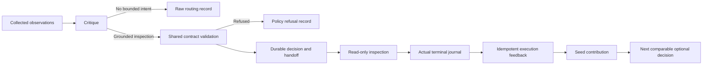

# Terrarium and action evidence

The observatory reports evidence from the existing home. It does not write Seed
state, grant execution authority, or turn a model's interpretation into a verified
operation. The same distinctions apply to the autonomous action loop.

## A bounded inspection is a capability

Fresh autonomous critique proposals use `home23.bounded-agenda-intent.v1`:
`operation` (`inspect` or `verify`), a `targetRef` supplied by the runtime,
`question`, `expectedEvidence`, `stopCondition`, and the supplied `evidenceRefs`.
The runtime preserves that contract through compilation, the agenda store, motor
policy, diagnostic handoff and the consumer. Wording is not an execution grant.

Malformed or missing typed metadata cannot select the legacy repair toolbox.
Existing stored legacy records retain their interpretation; they are not rewritten.
An explicit empty agenda remains silence, not a task manufactured from thought
prose. Accepting an inspection does not authorize remediation.

Typed inspections run in an `inspection:` chat with a bounded, seeded read-only
registry. It permits specific status reads, confined regular-file reads and a
constant-command process snapshot. It excludes shell, writes, scheduling changes,
messaging, delegates and network tools. Provider-native tools must obey the same
capability boundary. The generic registry cannot become a fallback toolbox for
an inspection chat.

## Routing, execution and outcomes

Prospective routing records carry `routingVersion: 2`, an occurrence identity and
a bounded reason code. No bounded intent, policy refusal, queueing, dispatch,
simulation, and execution disposition are different states. A dispatch does not
prove an attempt completed, and execution completion does not prove task success
or owner value.

Confirmed new `no_bounded_intent` telemetry stays in the raw event ledger but does
not enter the Seed diet or reset its quiet clock. Other new routing stages have
distinct source-prefix affinity keys. A policy rejection cannot teach a source
affinity that later attracts neutral silence into a correction cell. Legacy,
unknown and contradictory records are not silently discarded or relabeled.

Optional inspection learning retains the original decision, target and execution
identity. Native terminal journal evidence grounds completion; callback prose and
a claimed `fixed` result cannot substitute. A lost callback can reconcile the
existing outcome without running the inspection again. Later comparable optional
inspection choices consume that contribution. Owner-owed and critical work retain
their authority and are not silently cancelled by optional-action learning.

## Estimates remain estimates

Fresh lobe admission refuses a related ordinary estimate that merely refreshes
its age or confidence on unchanged evidence. A revision needs explicitly cited,
newer collected evidence relevant to that claim. Previous lobe prose, an unrelated
contact, and an operational question do not constitute a new observed outcome.
Advisory observations and interpretations remain available for exploration.

This guard recognizes conservative near-repeats. It does not certify a novel
estimate or solve arbitrary semantic equivalence. Existing accepted receipts keep
their historical replay behavior. The prompt's evidence-stage view distinguishes
routing decisions, pending execution, terminal outcomes and reported verification.

## Observatory evidence

- Host's declared roster and ownership bindings determine the process inventory,
  including supported continuation services. A process name or an HTTP 200 alone
  does not establish functional health.
- JSONL reads have byte budgets and report coverage. Checkpoint-derived cells,
  ledger head, latest lobe call, estimate text and function probes have separate
  timestamps. A recent input is not proof that all cognition works.
- Per-resident learned lessons come from the accepted durable learning view.
  A displayed choice joins its retained witness and actual retrieval identity.
  Missing or conflicting evidence stays unavailable; there is no hard-coded
  teaching-success row or global ownership score.
- An outbox row is an intent. Operator-reach displays join delivery receipts and
  current commitment state. Canonical message commitment is not proof of a phone
  notification or human attention. Closed, expired and unconfirmed history does
  not appear as a fresh delivered request.
- A commitment's deadline differs from its next concern threshold crossing and
  refractory/throttle conditions. That crossing schedules operator-reach
  deliberation, not the next autonomous engine action. The concern law is retained.
- Growth proposals are pending, declined, applied, or unresolved in the available
  window. Displaying a proposal does not execute anatomy changes.

The repair preserves the existing residents, history, encoder and deliberate
agency settings. Live verification must separately establish the installed
package, ownership/bindings, preserved state, actual inspection execution and the
resulting feedback. Fixture tests, a running process, a declared completion and
an owner-observed result remain different evidence.
