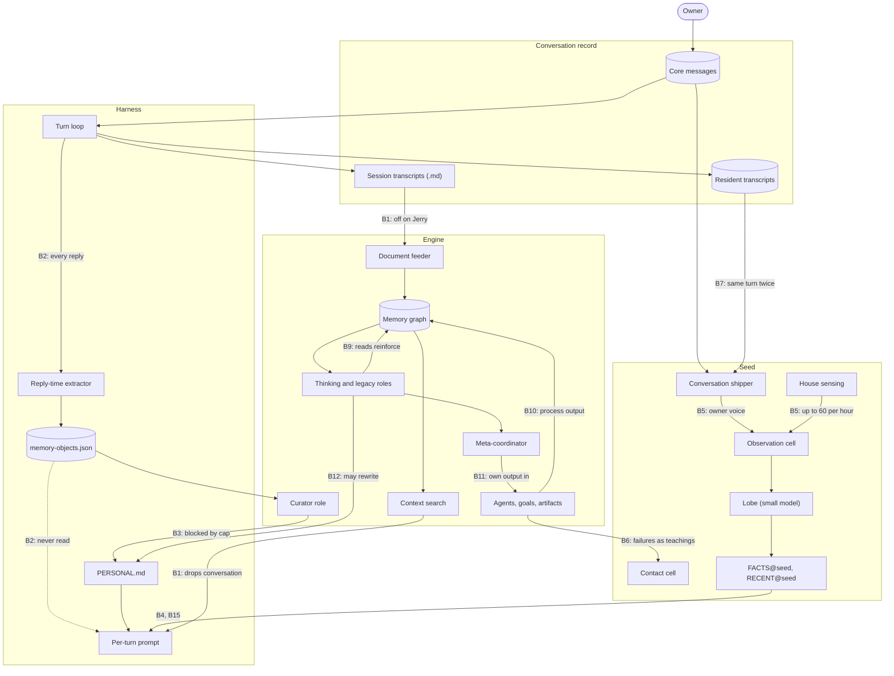
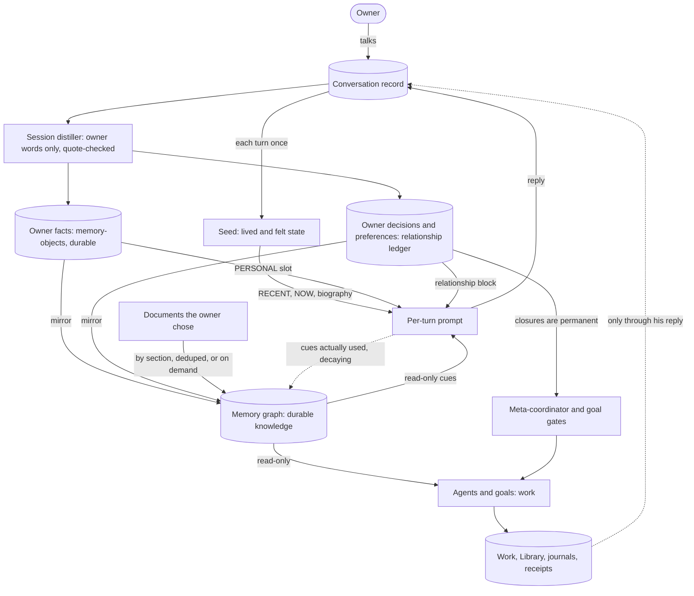

# Symbiosis: residents learn the owner from conversation

**Status:** design proposal, 2026-10-13. Nothing here is implemented or deployed.
**Scope:** engine memory graph, substrate (Seeds), harness context. It builds on
[Step 20 situational awareness](STEP20-SITUATIONAL-AWARENESS-ENGINE-DESIGN.md),
[the v2 substrate](HOME23-V2-SUBSTRATE-DESIGN.md),
[cognition feedback and contact](COGNITION-FEEDBACK-AND-CONTACT.md) and the
strategic goal gate from [PR #31](https://github.com/notforyou23/home23/pull/31).
It does not change Seed law, the configured encoder, or the home layout.

## Summary

The owner (Jason; `jtr` in code) wants Jerry and Forrest to learn him by
talking with him. Today the house does the opposite.

**What happens now.** His messages reach each resident's Seed, but they land in
the same cell as the house sensors, which can send 60 events an hour. His words
can be pushed out of that cell's short memory within the hour, and the audit
measured their salience at close to zero. The Seed's small model is told to
propose operational state changes, not to learn about him, so the "facts" it
produces are guesses about the house and the machine. The memory brain never
sees his chats on Jerry, because Jerry's document feeder is off, and on any
resident the per-turn brain search deliberately drops conversation material. A
step already turns conversations into notes about him, but it writes them to a
list that nothing reads: the notes are never promoted, and the one route into
`PERSONAL.md` is blocked by that file's size cap. Meanwhile the brain fills with
its own work: file pointers, goal records, agent findings and thoughts. Every
time the machine reads its memory, it marks what it read as more important, and
the most-used things in Jerry's brain are now pointers to files Jerry itself
wrote.

**What changes.** Each piece gets one job:

- **Conversations with the owner are the main input.** After each conversation,
  the resident writes down what he said about himself and what he decided, but
  only what it can back with his exact words. It reads them on every turn,
  beside `PERSONAL.md`.
- **The Seed** carries what is alive and how it feels: who was in touch, what is
  unresolved, what it expects. It hears each of his messages once, above the
  house noise. It is not where facts about him are kept.
- **The memory brain** keeps durable knowledge: his facts and decisions, plus
  documents he chose, split by section without duplicates or bare headings.
- **Agents do work.** Their results live in Work, Library and logs. They become
  knowledge only when he asks for them or accepts them.
- **Feedback cannot loop.** Work logs never come back as memory. The machine's
  own reading never makes something important, importance fades unless he uses
  it, and when he closes something it stays closed.

**What we do not add:** no new memory store, process, review queue or ritual.
The plan finishes pipelines that already exist and switches off the ones that
echo. It replaces a model call after every reply (once a conversation passes
ten messages) with one call per conversation.

**Order of work.** (1) Learn from conversations: the biggest change for him and
a small one in code. (2) Stop the brain echoing itself. (3) Teach the brain his
facts and make his closures permanent. (4) Let the Seed hear him. (5) Clean up
ingestion. (6) Give Jerry a fresh memory brain and clean Forrest's. Old brains
are archived, and nothing is deleted without his say.

**What we need from him** is in [the last section](#5-open-questions-for-the-owner):
where learned facts live, what must never be written down, which devices count
as him, how quiet the house should be, and whether Jerry starts fresh.

## Evidence and conventions

- Live numbers come from the owner's read-only audits of Jerry and Forrest on
  2026-10-11 to 2026-10-13. They were not re-measured for this document.
- File references are `path:line` in this repository at `main` commit
  `58f1f41e`. The house runs a packaged release updated through Host, so the
  running code can lag this source. Where the audit and the source disagree,
  the difference is called out.
- Audit figures used below:
  - Jerry's brain has 100,295 nodes, 78% from a July–August bulk feed: about
    22.3k bare headings, 22.7k exact duplicates, 12.6k chunks truncated at
    exactly 3,000 characters and 8.8k starting mid-sentence. Its most-accessed
    nodes are its own July artifact pointers (up to 11,457 accesses) and
    `[GOAL_RESOLUTION]` records. In a 20-query test, 12% of the top-10 results
    were bare headings and 4.5% were stale Substack material.
  - Monthly input in September–October was about 3.5k agent and goal outputs,
    2k consolidations, 0.7–1.25k research, 500 thoughts and a feeder trickle.
    Live chats never entered the graph.
  - Forrest has 40,777 nodes whose core is 11,816 chunks of real health
    conversation, imported from sessions.
  - Of 105 recent turns, 62 had no brain cues and 17 loaded FACTS@seed.
    `PERSONAL.md` (2.4 KB) is unchanged since Sep 23, `MEMORY.md` since Sep 24,
    and `workspace/memory` session summaries stopped on Aug 25.
  - The Seed model step wrote 5,585 claims; 169 cite chats, the last on Sep 29,
    and the claims are operational speculation rather than facts about him.
    Recent direct-message turns scored about 0.003 salience while house
    sensors sent 77k events into one cell. The conversation streams hold
    duplicated turns (reported as 676/330), and the paired Home device's
    writes count as the owner.

## 1. Current flow

### Where it runs backwards

**A. Owner conversation never becomes knowledge**

| # | What happens | Where |
|---|---|---|
| B1 | Chats do not reach the graph. The feeder is the only route, it is off on Jerry, and the per-turn search drops conversation-tagged and consolidated nodes. That filter was added on Sep 10 (`049426fe`) so imported documents were not buried. Elsewhere conversation only weights which graph clusters the engine thinks about. | `engine/src/core/orchestrator.js:934-966`, `cli/lib/agent-config-builder.cjs:10-17`, `engine/src/dashboard/memory-search.js:1215-1220`, `:1375`, `engine/src/core/orchestrator.js:414-421`, `engine/src/cognition/conversation-salience.js:1-21` |
| B2 | The reply-time extractor is a dead end. It runs after every reply once history exceeds 10 messages and re-reads the last 30 messages, clipped to 500 characters each. It writes `working`/`candidate` objects, drops the `domain` it asks for, and dedupes only by exact title. The prompt only reads `durable` objects, and no code promotes working objects to durable: Step 20's promotion step was never built, and the v2 document records 2,500 candidates that never graduated. `promote_to_memory` says "durable" but writes working candidates. | `src/agent/loop.ts:2343-2345`, `:2644-2646`, `:2885-2887`, `:3235-3237`, `src/agent/memory.ts:70-88`, `:105`, `:147-166`, `:201-242`, `src/agent/trigger-index.ts:27-36`, `src/agent/memory-objects.ts:385-387`, `docs/design/STEP20-SITUATIONAL-AWARENESS-ENGINE-DESIGN.md:405-420`, `docs/design/HOME23-V2-SUBSTRATE-DESIGN.md:12-15`, `src/agent/tools/promote.ts:18`, `:141-142` |
| B3 | The bridge into `PERSONAL.md` is blocked. It lives in the legacy curator role, which still runs beside the thinking machine because `executeCycle` has no cognition-mode guard. It routes by `applies_to` keywords rather than domain. It appends only when an entry fits under a 2,500-character cap and compacts only when the file is already over it. A 2.4 KB `PERSONAL.md` therefore accepts only entries under about 100 characters, and the rest stay candidates indefinitely. This is consistent with `PERSONAL.md` being unchanged since Sep 23. The daily `workspace/memory/*.md` files are only a fallback, and pre-compaction extracts are off by default, so their absence after Aug 25 does not mean extraction stopped. | `engine/src/core/orchestrator.js:1589`, `:2746-2748`, `:3441-3595`, `:3475-3490`, `:3517-3531`, `:3558-3562`, `engine/src/core/curator-cycle.js:22-28`, `src/agent/memory.ts:124-137`, `src/agent/compaction.ts:43`, `:190-197` |
| B4 | The Seed's facts cannot be about him. v2 meant the Seed to mature promoted knowledge into facts, but its lobe is told it is "not writing memory, narrative, or identity" and is asked for typed operational deltas. FACTS@seed also needs at least two evidence refs still among the cell's last 32 refs after the estimate has outlived 200 chain records. A cell that takes most of the traffic turns over its 32 refs before 200 records pass, so only estimates in quieter cells, which hold operational material, can qualify. | `src/agent/tools/promote.ts:181-187`, `substrate/src/lobe.ts:50-57`, `:569-643`, `:603-604`, `src/substrate/lived-facts.ts:35-40`, `:63-78`, `substrate/src/cells.ts:146`, `:226-228` |

**B. The Seed weighs the house over the owner**

| # | What happens | Where |
|---|---|---|
| B5 | His voice shares a cell with the house. Conversation turns are `observation` events, routed by category to the observation-role cell, which also takes house events (`world.home` in new births, `world.home23` in the default anatomy). House sensing can ship 60 events an hour by default; each cell keeps 32 refs, and a lobe packet carries the last 8 refs of at most 2 admitted cells. Salience is a learned projection of reservoir state with no term for who is speaking, so nothing in it would lift the 0.003 the audit measured for his messages. | `substrate/src/adapters/event-ledger-tail.ts:451-482`, `:469`, `substrate/src/cells.ts:91-100`, `:109-134`, `cli/lib/seed-birth.js:19-25`, `substrate/src/types.ts:195-201`, `substrate/bin/house-sense.ts:37-39`, `substrate/src/workspace.ts:28`, `:37`, `:121`, `substrate/src/metabolism.ts:146-173`, `:233-259` |
| B6 | Machine failures train the cell named for him. Failed, blocked or rejected work and actions, rejected motor routing and failed worker runs are `correction` events. They route to the correction-role cell, which births name `contact.owner`, and `correction.v1` develops that cell as if taught: lower wake threshold, more routing affinity and trust for the failing source. | `substrate/src/adapters/event-ledger-tail.ts:44-50`, `:80-81`, `:118`, `:537-539`, `cli/lib/seed-birth.js:20`, `substrate/src/seed.ts:757-780`, `substrate/src/plasticity.ts:197-237` |
| B7 | One turn can arrive twice, and "owner" is too broad. The shipper reads both legacy transcripts and Core's projection, the two copies get different identities, and the Seed does not dedupe transitions by event id. Canonical contact counts any owner-principal message as his voice, and messages record no device, so a paired Home device's writes count as him. Legacy `user` lines default to the owner, including Telegram group files (negative ids match the file pattern). | `substrate/src/conversation-shipper.ts:33-37`, `:75-76`, `:81`, `substrate/src/adapters/event-ledger-tail.ts:468`, `substrate/src/seed.ts:659-743`, `src/coordination/app/resident-contact.ts:57-58`, `src/coordination/channels/schema-delta.ts:201-228`, `substrate/src/conversation-turn.ts:37-39` |
| B8 | Clay never hears his conversations. Declared seeds receive only the sources configured for them, and Clay was born without a harness or engine. Whether it should hear him is a question for him. | `cli/lib/generate-ecosystem.js:607-655` |

**C. The graph learns from itself**

| # | What happens | Where |
|---|---|---|
| B9 | Reading reinforces. `query()` marks access by default (+1 access count, +0.1 weight). Every thought queries memory and links its context, and every agent finding or insight writes a node, queries its neighbours and links them. Access counts never decay; only weight does. Discovery treats 20 or more accesses as permanent. This rich-get-richer loop is consistent with artifact pointers at 11,457 accesses. | `engine/src/memory/network-memory.js:1576-1590`, `:2276`, `:2328-2340`, `:2835-2846`, `:3160-3212`, `engine/src/core/orchestrator.js:2812`, `:3280-3286`, `engine/src/agents/base-agent.js:284-311`, `:375-402`, `engine/src/cognition/discovery-engine.js:100-103`, `:867` |
| B10 | Process output is filed as knowledge: an "Artifact id: kind / path=" mirror for every registered file and memory promotion, artifact extracts, thoughts and `[REASONING]`, summaries and consolidations of all of it, dreams, and the engine's own `promote_to_memory` at up to 120 an hour. One rule is already right: goal resolutions are written only for goals the owner asked for. | `engine/src/artifacts/artifact-registry.js:203`, `:241`, `:273`, `:414-441`, `engine/src/artifacts/artifact-ingestor.js:20-58`, `engine/src/core/orchestrator.js:1521-1565`, `:4415-4418`, `:4442-4456`, `:4559-4615`, `:4840-4843`, `engine/src/cognition/actions/promote-to-memory.js:8-30`, `configs/action-allowlist.yaml:31-36`, `engine/src/goals/goal-curator.js:298-305` |
| B11 | Strategy reads only the machine. The meta-coordinator decides from its own thoughts, goals, memory statistics, agent results, deliverable gaps and sensors, then mints goals from them. His conversation and decisions are not inputs. PR #31 filters what comes out, not what goes in. | `engine/src/coordinator/meta-coordinator.js:1855-1910`, `:1977-2001`, `:2719`, `:2844`, `engine/src/coordinator/strategic-goal-gate.js` |
| B12 | The machine can rewrite his file. The engine's `update_surface` action may append to or replace `PERSONAL.md`. | `configs/action-allowlist.yaml:49-62`, `engine/src/cognition/actions/update-surface.js:16`, `:33-45` |

**D. Ingestion manufactured junk**

| # | What happens | Where |
|---|---|---|
| B13 | Oversized paragraphs are cut by a fixed 3,000-character window with 300 characters of overlap, which produces exactly-3,000 chunks and mid-sentence starts. A chunk's heading path is metadata, not text, so a chunk does not say which section it came from. Dedupe works per source file only, so identical text from two files becomes two nodes. Standalone headings were fixed on Sep 21 (`3fa59742`), but the July–August nodes remain. | `engine/src/ingestion/document-chunker.js:6-8`, `:73-86`, `:423-441`, `:452-478`, `configs/base-engine.yaml:675-677`, `engine/src/ingestion/ingestion-manifest.js:289-299`, `:698-707` |
| B14 | The same dialogue is written twice. The live snapshot is rewritten after every turn and the boundary transcript repeats the session; the normalizer accepts both as transcripts. | `src/agent/loop.ts:495-531`, `:533-577`, `engine/src/ingestion/transcript-normalizer.js:20-32` |

**E. What the harness reads each turn**

| # | What happens | Where |
|---|---|---|
| B15 | Lived surfaces wait on the graph. RECENT@seed, FACTS@seed, TOPOLOGY, PROJECTS and DOCTRINE load only on a first turn, when there are cues or triggers, or when retrieval is degraded. A conversation gives the graph 150 ms; after that the turn continues as "pending", which does not count as degraded. The slower the brain, the less lived context reaches his turns. The audit saw RECENT@seed on every turn, although most turns had no cues and current source loads it only on first turns, turns with cues or triggers, or degraded retrieval. Either the running package differs or those turns counted as first or degraded. The `RetrievalExecuted` records in the event ledger show which, and PR 1's acceptance check reads them. | `src/agent/context-assembly.ts:840-841`, `:885-886`, `:709-710`, `src/agent/context-enrichment.ts:4`, `:85` |
| B16 | Seed surfaces depend on a setting nothing writes. RECENT@seed, FACTS@seed, SUBSTRATE and NOW@seed need `situationalAwareness.substrate.stateDir`, which is not in `HomeConfig` and is not written by any installer; only the biography derives its path. A new home born with a Seed does not get these surfaces. | `src/agent/loop.ts:1622`, `src/agent/session-bootstrap.ts:30-38`, `src/types.ts:206-219`, `config/home.yaml.example:224-228`, `src/agent/context.ts:174-176` |

The pattern: twice the house designed a path from conversation to knowledge
(Step 20 memory objects, then v2 Seed estimates), and neither path closes.
Meanwhile every path from the machine's own activity back into memory is open
and self-reinforcing.

## 2. Target architecture

### One job per piece

| Piece | Job | Holds | Never |
|---|---|---|---|
| Conversation record: Core messages and resident transcripts | Evidence | What was said, by whom, when | Rewritten or summarized in place |
| Owner knowledge: facts in `memory-objects.json`, decisions in the relationship ledger | What the resident knows about him and what he decided | Statements backed by his quoted words, with message refs, dates and supersession | Written from the resident's own words, agent output, thoughts, dreams or Seed estimates |
| Seed | Lived and felt state | Contact, salience, intentions, expectations; RECENT, NOW and the biography | Treated as a store of facts about him |
| Memory graph | Durable knowledge for retrieval and engine cognition | A mirror of owner knowledge, plus documents he chose | Logs of its own work; reinforced by its own reading |
| Agents and goals | Work | Deliverables in Work and Library, journals, receipts | Writing knowledge directly |
| Harness | Reads each turn | Identity files, the PERSONAL slot (his file plus learned facts), the relationship block, lived surfaces, read-only cues | Writing memory outside the distiller and explicit tools |

Facts and decisions use the two stores already documented for them. The
relationship ledger describes itself as the working relationship ("decisions
reached together", preferences, aversions) and points facts about the world to
memory objects (`src/agent/relationship-ledger.ts:1-29`). Both are already read
on every turn: `PERSONAL` is always loaded (`src/agent/context-assembly.ts:96-111`)
and the relationship block is ranked into 1,400 characters
(`src/agent/loop.ts:1660-1676`). Writing to these stores avoids a third.
Owner-authenticated corrections keep their existing in-turn path
(`src/agent/memory-objects.ts:91-106`, `src/agent/relationship-ledger.ts:318-343`).

### The distillation contract

- **Input:** finished sessions from the canonical contact stream the Seed and
  engine already read, `instances/<agent>/substrate/conversation-stream.jsonl`.
  A resident without a Seed reads Core's projection,
  `instances/.house/coordination/resident-contact/<agent>.jsonl`. A session is
  a run of contact with no message for the session gap (30 minutes by default),
  measured on message timestamps. Duplicate copies of a turn are collapsed first.
- **Evidence:** only the owner's own turns. Resident turns are context. Group
  chats, scheduled runs and runtime inputs are excluded.
- **Output:** JSON lines of
  `{kind, statement, quote, messageRef, supersedes?, privacy}`, where `kind` is
  `fact` (about him or his world), or `decision`, `preference` or `aversion`
  (how he wants the resident to act, including topics he closed).
- **Gate, in code, not the model:** the quote must appear in the cited message
  after whitespace, case and quote-mark normalization. The cited message must be
  owner voice in the same session. Statements are bounded, and secrets are refused.
- **Writes:** facts become durable memory objects with
  `generation_method: owner_conversation`, the quote as `grounding_note` and the
  message ref as evidence. Decisions, preferences and aversions become
  relationship entries with the quote as `evidence_note`. A repeat adds evidence
  and refreshes the date. `supersedes` marks the earlier item superseded; it is
  kept, never deleted.
- **Read:** the PERSONAL slot appends "Learned from conversations", composed at
  read time from active, non-sensitive owner facts. It is ranked by relevance to
  the turn and recency, uses the same scoring idea as
  `src/agent/relationship-ledger.ts:688-702`, has a budget of about 2,000
  characters, and dates each line. It extends a surface that already loads every
  turn rather than adding one, so the "nothing new rides every turn" rule
  (`src/agent/context-assembly.ts:119-122`) holds.
- **What "verified" means:** traceable (an exact quote and message id),
  attributable (his voice, not the resident's), and current (not superseded by
  a later statement of his). It does not mean true in the world; the resident
  still says "you told me on <date>".

### Feedback paths that cannot echo

1. **Owner to knowledge.** Only his quoted words create or supersede owner
   knowledge.
2. **Use to importance.** Only items placed into a turn with him count as use,
   and use decays with a half-life of about 30 days. Machine reads are read-only.
   The harness already reports surfaced relationship entries this way
   (`src/agent/relationship-ledger.ts:577-590`).
3. **Owner closures are permanent.** A decision of his that stops or closes a
   topic, like a goal he archived with an `owner:` reason, blocks every
   machine-initiated goal source until he reopens it. Today only strategic
   goals are gated (`engine/src/coordinator/strategic-goal-gate.js`).
4. **Work reaches knowledge only through him.** Agent and goal output stays in
   Work, Library and logs. It becomes knowledge when his reply is distilled, or
   as an owner-requested goal resolution, which is already the rule
   (`engine/src/goals/goal-curator.js:298-305`).
5. **Seed to prompt.** The Seed supplies lived surfaces. Its estimates stay the
   resident's own conclusions, labelled as such (`src/substrate/lived-facts.ts:85-89`).
6. **Dreams stay dreams.** Day residue already excludes prior dreams
   (`engine/src/substrate/seed-lived-state.js:179-203`). Dream text goes to
   `dreams.jsonl` and the Seed's dream receipt, not to the graph.

### Ingestion rules

- Split by section; each chunk starts with its heading path.
- Split an oversized section at paragraphs, then sentences. The fixed window
  remains only for text without sentence boundaries, such as code and tables.
- Merge or drop chunks that are only a heading or label.
- Normalize and hash content across all sources, so identical text becomes one
  node with several sources.
- For bulk folders, offer an on-demand mode: one catalog node per document
  (title, the compiler synthesis `engine/src/ingestion/document-compiler.js`
  already produces, and path), with full text read by tools when needed.
- Conversation transcripts are not chunked into the graph by default; the
  distiller carries conversation into knowledge.

### What stays as it is

Seed law (one runner per individual, no chain repair, typed deltas, event time),
the configured encoder (`docs/design/HOME-UPDATES-AND-PORTABILITY.md:55-77`), the
membrane's refusal of memory and identity writes (`substrate/src/membrane.ts:36-41`),
authored identity files, the thinking machine, PR #31's gate and RECENT@seed's
composition.

## 3. Migration of existing brains

### Rules

- Nothing is deleted. Each old brain is archived whole and stays readable;
  "quarantine" means moving nodes into the archive.
- Only the memory graph changes. "Fresh Jerry" means a fresh graph, not a new
  Seed: the Seed is not reborn, repaired or migrated. `brain/` also holds goals,
  journal, coordinator and agent state inside `state.json.gz`
  (`engine/src/core/orchestrator.js:7565-7590`), plus memory objects, the
  relationship ledger, the event ledger and agency files. These stay.
- The established encoder recipe is kept, so new vectors match the attention
  gates calibrated for it (`shared/semantic-encoder-contract.cjs:39-52`).
- One resident at a time, in a window he approves, with a census before and after.

### Jerry: fresh graph (recommended)

About 78% of Jerry's graph is bulk-feed junk, its links, clusters and access
counts were shaped by the echo, it holds none of his conversations, and process
output dominates new input. A cleanup would keep the structure the echo built,
so the recommendation is a new graph seeded in this order:

1. **Identity:** the authored workspace files, one node per section, tagged
   `identity` (already permanent in discovery, `engine/src/cognition/discovery-engine.js:103`).
2. **Decisions:** active relationship-ledger decisions, preferences and
   aversions, and goals he archived with `owner:` reasons.
3. **Conversations:** PR 1's distiller run once over the whole history (Core's
   canonical messages plus legacy direct-message transcripts), producing owner
   facts and decisions. Raw transcripts are not chunked into the graph.
4. **Curated facts:** a reviewed whitelist from the old graph, namely owner
   corrections and owner-requested goal resolutions. Documents from folders he
   names are re-ingested from source with PR 5's chunker rather than copied.

Afterwards, references to old node ids are cleared (artifact-registry mirrors,
goal `resolutionNodeId`, agenda and thought `referencedNodes`), and derived
indexes (ANN, PGS partitions, pins) are rebuilt. The alternative, cleaning in
place, keeps those references valid but has to classify about 100,000 nodes by
heuristics and still carries the echo's structure.

### Forrest: cleanup in place (recommended)

Forrest's core is about 11.8k chunks of real health conversation, and its
most-used nodes are on topic. Archive it, then quarantine process-output tags,
exact duplicates (keeping the earliest) and heading-only or label-only chunks.
Keep the conversation chunks and his documents, and run the distiller over
Forrest's history under his privacy choices. Access counts need no reset once
PR 2 removes machine reinforcement and the permanence rule.

### Order for each resident

1. PRs 1–3 and 5 deployed and checked.
2. Read-only census, recorded as a receipt.
3. Stop that resident's engine only; the Seed and harness keep running.
4. Archive the brain directory and verify that the archive loads read-only.
5. Apply the reviewed rebuild or quarantine plan and record a receipt.
6. Start the engine, rerun the census and the audit's 20-query probe, and
   compare. Rollback means stopping the engine and restoring the archive.

## 4. Pull requests

Six PRs, in order. PR 4 does not depend on the others and can run beside PRs
2, 3 and 5.

| Backwards item | Addressed by |
|---|---|
| B1 chats never reach knowledge | PR 1 (distiller), PR 3 (mirror into the graph) |
| B2, B3 extractor and PERSONAL bridge | PR 1; PR 2 removes the curator's PERSONAL path |
| B4 Seed facts | PR 1 supplies owner facts; PR 4 lets the Seed hear him |
| B5, B6, B7 Seed diet, failures, duplicates | PR 4 (B6 only on his ruling) |
| B8 Clay | Open question 10 |
| B9, B10, B12 echo and process output | PR 2, with owner-use reinforcement in PR 3 |
| B11 strategy inputs | PR 3 |
| B13, B14 ingestion | PR 5 |
| B15 surfaces gated on cues | Not changed directly. PRs 2, 3 and 6 make cues meaningful and fast, which the gate assumes. If lived surfaces still starve after migration, give them the meaning gate AGENCY and WORKERS already use (`src/agent/context-assembly.ts:166-182`). |
| B16 unwritten Seed setting | PR 1 |

### How each one reaches the house

- Each PR is reviewed and merged to `main`, and a land receipt is recorded
  while it is committed but not yet running
  (`docs/reference/DEVELOPMENT-WORKFLOW.md:10-27`). Deployment needs the
  owner's authorization.
- The Mac Mini updates as a whole home. Build the Host payload from the reviewed
  commit (`scripts/product/package.mjs`), then run
  `host.mjs update --home <home> --payload <payload> --staging <staging>`
  (`scripts/product/host.mjs`) or the native Update. The update stops every
  writer, switches software, restarts, checks readiness and rolls back on failure
  (`cli/lib/product-update-apply.js:1310`).
- State is preserved: `instances/`, `config/home.yaml` and each agent's
  `config.yaml`. `configs/base-engine.yaml` and `configs/action-allowlist.yaml`
  ship as software (`cli/lib/product-payload.js:133-167`). New defaults
  therefore arrive with the update, but per-agent overrides still win; for
  example, Jerry's `feeder.enabled: false` stays.
- Data operations (backfill, rebuild, quarantine) never run as a side effect of
  an update. They are explicit commands with a dry run and receipts.
- Each PR's check on the Mini is a single bounded acceptance check, not a
  recurring report ("one knife per decision",
  `docs/design/HOME23-V2-SUBSTRATE-DESIGN.md:165-166`).

### PR 1: Learn the owner from conversation (highest leverage)

Mostly harness, with one guard in the engine.

**Scope**
- Remove the reply-time extraction calls (`src/agent/loop.ts:2343-2345`,
  `:2644-2646`, `:2885-2887`, `:3235-3237`) and `/reset`'s call
  (`src/commands/handler.ts:160-183`). Replace them in `src/agent/memory.ts`
  with the session distiller from section 2.
- Run it in the background in the harness at start and every 15 minutes, over
  finished sessions past a small cursor kept in `brain/`. It never delays a reply.
- Add the PERSONAL-slot tail in `src/agent/context-assembly.ts`, where PERSONAL
  loads (`:864-875`). Degrade to `PERSONAL.md` alone if the store is unreadable.
- Make the engine's shared-store eviction skip durable owner facts
  (`engine/src/channels/memory-ingest.cjs:236-253`; it archives the oldest
  objects beyond 2,500 regardless of layer).
- When `situationalAwareness.substrate` is absent and the agent has a Seed,
  derive its state directory the way the biography does
  (`src/agent/context.ts:174-176`). Homes that already set it see no change (B16).
- Configuration `chat.ownerDistill`: `enabled` (default true), an optional model
  alias (default: the resident's chat model) and budgets. Turning it off leaves
  existing objects in place.
- Out of scope: corrections, the graph, the Seed and the engine curator. The
  curator only takes working candidates (`engine/src/core/orchestrator.js:3469`),
  so it ignores the new durable objects.

**Risks**
- Wrong or over-literal facts from hypotheticals, jokes or quoted third parties.
  The quote gate and kind rules limit this; he can correct the resident in
  conversation, which supersedes the item.
- Privacy. Sensitive items are stored but never rendered, matching the
  relationship rule (`src/agent/loop.ts:1665-1668`). He sets the policy for each
  resident.
- Attribution, from legacy group chats and the paired device (B7). Exclude group
  files now; device attribution waits for his answer.
- Cost: one bounded model call per session, fewer than today's call after every reply.
- Prompt growth: a fixed budget in the dynamic suffix, so the stable prefix's
  cache is unaffected (`docs/reference/CONTEXT-MANAGEMENT.md:52-66`).
- Concurrency: `memory-objects.json` is shared with the engine bus and already
  locked (`src/agent/memory.ts:243-256`).
- Distilled decisions enter the Seed's diet as relationship observations, as
  agent notes already do (`substrate/src/adapters/event-ledger-tail.ts:488-517`).

**Tests**
- New `tests/agent/owner-distill.test.ts` with scripted model replies: quote gate,
  owner-only evidence, refs outside the session rejected, duplicate turns
  collapsed, supersession, privacy, and a cursor re-run producing no duplicates.
- Extend `tests/agent/memory-objects-provenance.test.ts` and
  `tests/agent/relationship-ledger.test.ts`. Cover PERSONAL-slot composition
  (budget, sensitive items excluded, unreadable store) and the derived Seed
  state directory, and confirm nothing runs per reply.
- Extend `tests/engine/channels/memory-ingest.test.cjs` for the eviction guard.
- Register the new tests in `package.json`'s `test` list.

**Rollout**
- Harness and engine restart with the Host update. The first pass covers the
  last 14 days only; the full-history backfill belongs to PR 6.
- Acceptance on the Mini: talk with Jerry, wait past the session gap, then check
  that durable owner objects with quotes exist and that `/prompt` shows them in
  the PERSONAL slot. The same check settles B15's discrepancy.

### PR 2: Stop the brain echoing itself

Engine.

**Scope**
- Machine reads stop reinforcing: `query()` becomes read-only by default
  (`engine/src/memory/network-memory.js:2276`). Remove co-occurrence links after
  agent writes and thoughts (`engine/src/agents/base-agent.js:306-311`,
  `:397-402`, `engine/src/core/orchestrator.js:3280-3286`).
- Reinforcement decays: discovery stops treating 20 or more accesses as permanent
  (`engine/src/cognition/discovery-engine.js:100-103`, `:867`).
- Process output stays in logs: stop writing artifact mirrors, artifact
  extracts, `[REASONING]`, introspection and `[DREAM]` nodes, consolidations
  built only from process output, and agent findings and insights for
  machine-initiated work. Agent
  journals, the artifact registry, goal history and thought logs already hold
  them. Move agent repeat-work detection from answer-tagged graph nodes
  (`engine/src/agents/dedup-before-spawn.js:15`, `:43-60`) to the agent journal.
- Existing process-tagged nodes are excluded from context search
  (`engine/src/dashboard/memory-search.js:1215-1220`) and from discovery and
  consolidation candidates until migration.
- The machine cannot write his file: remove PERSONAL from `update_surface`
  (`configs/action-allowlist.yaml:57-62`, `engine/src/cognition/actions/update-surface.js:16`)
  and from the curator's surface map (`engine/src/core/orchestrator.js:3493-3498`).
  Disable the engine's own `promote_to_memory` (`configs/action-allowlist.yaml:31-36`).
- Configuration `memory.processOutput: log` (default) or `graph` (old behavior).

**Risks**
- Agents repeating work: detection moves to the journal, and PR #31 already
  dedupes strategic goals.
- Views that show artifact nodes must read the artifact registry instead.
- Engine cognition becomes quieter until PR 3 gives it his world to think about.
  That is intended.

**Tests**
- `tests/engine/memory/network-memory-access.test.js` (read-only by default) and
  agent tests (no reinforcement).
- Artifact registry (no mirror by default), repeat-work detection from the journal.
- Discovery decay without access permanence, the context-search exclusion, and
  `update_surface` refusing PERSONAL.

**Rollout**
- Engine restart with the Host update.
- Acceptance: a census before and a day after shows process tags no longer
  growing and the top access counts frozen. Revert through configuration.

### PR 3: Teach the brain the owner; make his closures stick

Engine, plus a small harness report.

**Scope**
- Mirror owner knowledge into the graph. The engine keeps one node per durable
  owner fact and active owner decision, keyed by its id so the mirror is
  idempotent. Superseded items are marked superseded, and sensitive items are not
  mirrored. Owner nodes are never echo-filtered and rank above document chunks
  in context search. This is the same mirror pattern artifacts use today.
- Usage counts only when it reaches him: the harness reports which cue ids it
  placed in a turn with him, and the engine records that use with a decaying score.
- Owner closures are permanent: the owner-closure check covers active owner
  decisions as well as `owner:` archives. It applies to every goal source other
  than his own requests (`engine/src/goals/intrinsic-goals.js:64-68`), including
  dreams and thought capture, not only strategic goals. The meta-coordinator's review sees a short list of his active
  decisions and priorities (`engine/src/coordinator/meta-coordinator.js:1977-2001`).
  It does not see his personal facts, so the machine does not mint goals about
  his private life.

**Risks**
- Owner facts become visible to graph tools and exports; privacy classes apply.
- A stale mirror if supersession does not propagate.
- The closure check over-blocking a new topic that shares words with a closed one.

**Tests**
- Mirror idempotence and supersession, and owner-node ranking.
- A goal on a closed topic is refused from each machine source with an
  owner-decision reason.
- The coordinator prompt includes decisions but no facts.
- Usage reports produce a decaying score.

**Rollout**
- Engine and harness restart with the Host update.
- Acceptance: one owner fact is found by `brain_search`, and one goal on a topic
  he closed is refused with the logged reason.

### PR 4: Let the Seed hear the owner

Substrate. Follows Seed law.

**Scope**
- Ship each turn once. When Core's projection already carries the same role,
  text and timestamp, skip the legacy line (`substrate/src/conversation-shipper.ts:33-90`).
  Do not voice legacy group files as him (`substrate/src/conversation-turn.ts:37-39`).
  Duplicates already in the chain stay there; the chain is never repaired.
- Quiet the house: lower the default house rate and per-entity cooldown
  (`substrate/bin/house-sense.ts:37-39`) so his contact outlasts the shared cell's
  32-ref window. He chooses the numbers.
- Optional, only on his ruling: give his voice its own cell through the existing
  receipted growth split by source prefix (`substrate/src/growth.ts:317-365`;
  today's floors keep a small share from qualifying, `:31-36`), and route
  machine failures away from his contact cell (B6). Both change how the
  individual develops, so neither ships without his decision.

**Risks**
- Dropping a legacy-only turn, such as a Telegram direct message; skip only when
  a canonical twin exists.
- Replay determinism: the changes affect new events only, which the replay check confirms.
- Runner restarts: never two runners for one individual.

**Tests**
- Extend `substrate/tests/conversation-shipper-entry.test.ts` and
  `substrate/tests/conversation-shipper-stamp.test.ts` for dedupe and attribution.
- `substrate/tests/adapter-runner.test.ts`, a house-sense cap test, and
  `npm run test:substrate`.

**Rollout**
- Run a standalone load test on a copy of each Seed's state before any restart
  (`docs/design/HOME23-V2-SUBSTRATE-DESIGN.md:158-160`; `substrate/bin/seed-replay-verify.ts`).
  Then apply the Host update, under which runners stop and start under their locks.
- Acceptance: one new owner turn adds one stream line, and after a busy house
  hour RECENT@seed still shows his last words.

### PR 5: Clean up ingestion

Engine. Can land any time before PR 6.

**Scope**
- Make the chunker follow section 2's ingestion rules instead of the fixed
  3,000-character window (`engine/src/ingestion/document-chunker.js:48-94`,
  `:381-441`, `:452-478`).
- Dedupe across sources (`engine/src/ingestion/ingestion-manifest.js:289-299`,
  `:698-728`), and add an on-demand catalog mode for each watch path.
- Drop `sessions` from the default watch folders for new residents
  (`cli/lib/agent-config-builder.cjs:10-17`). Existing per-agent watch paths are unchanged.

**Risks**
- Retrieval changes for documents.
- Re-ingest churn: unchanged files are not re-processed, because processing is
  keyed on content hashes.
- Compiler cost in catalog mode.

**Tests**
- Chunker unit tests: headings attach, no mid-sentence starts, size bounds, no
  heading-only chunks.
- Dedupe across files, `tests/engine/ingestion/document-feeder-policy.test.js` and
  `tests/engine/ingestion/transcript-normalizer.test.js`.

**Rollout**
- Engine restart with the Host update. Existing files are not re-ingested
  automatically, and Jerry's feeder stays off until PR 6.

### PR 6: Migrate Jerry and Forrest

Operator scripts. Each run needs explicit authorization.

**Scope**
- A read-only census: counts by tag and source class; junk classes (heading-only,
  exact duplicate, exactly 3,000 characters, mid-sentence start); process share;
  top-accessed nodes; and the audit's 20-query probe.
- Archive and verify.
- Jerry's rebuild and Forrest's quarantine as described in section 3. Each runs
  as a dry-run plan, then owner review, then an apply with a receipt, reusing the
  reviewed-apply pattern in `scripts/audit-brain-provenance.cjs` and the writer
  in `shared/memory-source/`.
- PR 1's distiller exposed as a one-time history backfill command.

**Risks**
- Data loss: archive first, delete nothing, record receipts.
- Dangling node references and stale derived indexes.
- Embedding time on the configured encoder, engine downtime, and disk space.

**Tests**
- Isolated fixtures, following `tests/scripts/isolated-brain-fixture.test.cjs`:
  census numbers, an idempotent apply, archive verification and quarantine
  reversal.

**Rollout**
- One resident at a time, following section 3's order.

## 5. Open questions for the owner

**Learning from you**

1. Where should "what I've learned about you" live? Recommended: in the
   resident's own memory, with your exact words, shown to it on every turn and
   read back to you when you ask "what do you know about me?". The alternative
   is adding it to your `PERSONAL.md` file.
2. What should never be written down, for Jerry and for Forrest? For example,
   health details for Jerry, money, or other people's private matters.
3. When you correct something, should the old version be kept and marked wrong,
   or removed?
4. Should the resident tell you when it learns something new about you, for
   example with one line at the end of a conversation, or stay quiet?

**The memory brain**

5. Is it all right for Jerry to start with a fresh memory brain? The old one would
   be archived and nothing deleted. Which document folders should come back?
6. Forrest holds about 11,800 pieces of your health conversations. Keep them
   alongside the new learned facts?
7. How far back should the residents learn from your past conversations: all of
   it since July, or a recent stretch?
8. Past agent findings and reports: should any count as knowledge, or only what
   you asked for or accepted?

**The Seed**

9. The paired Home device currently counts as you talking. Should it?
10. Clay does not hear your conversations with Jerry. Should it?
11. The house can send up to 60 events an hour into the Seed and crowd out your
    messages. May we turn that down, and to what?
12. When a machine job fails, the Seed treats it like a correction from you, in
    the place reserved for you. Should failures go to the work side instead?
13. Should your voice get its own place in the Seed? That changes its body, so
    only you can approve it.
